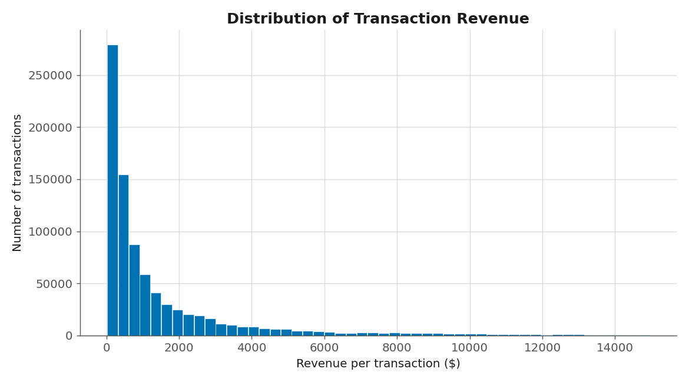
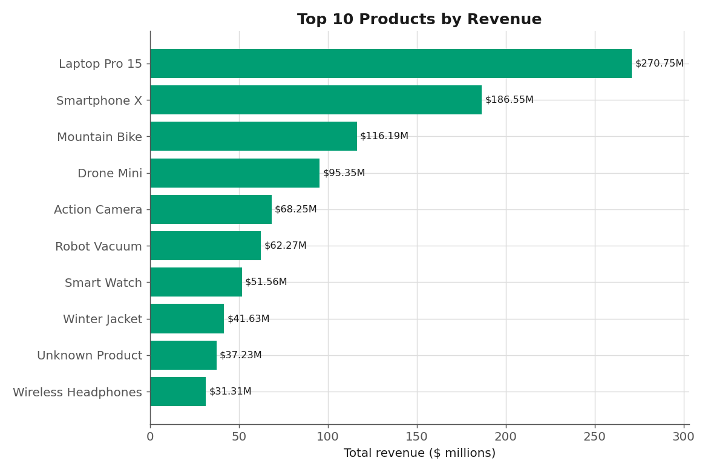
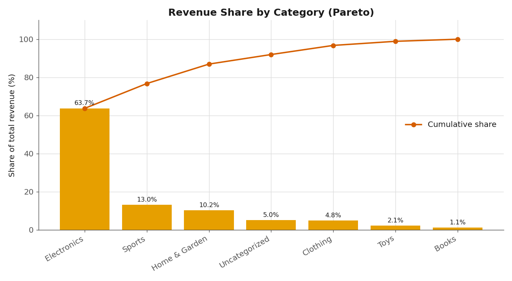
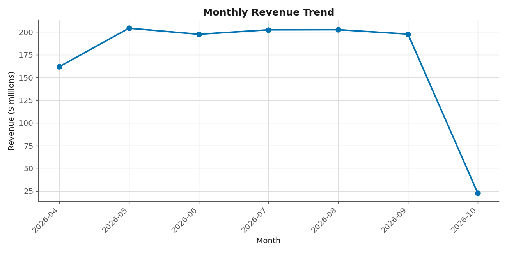
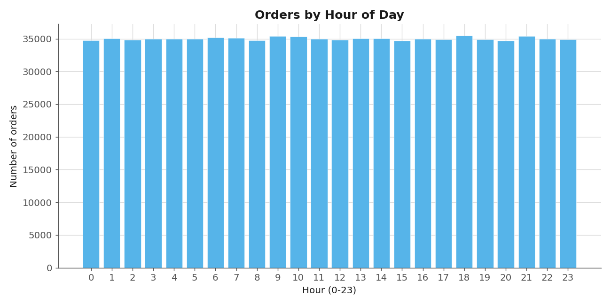
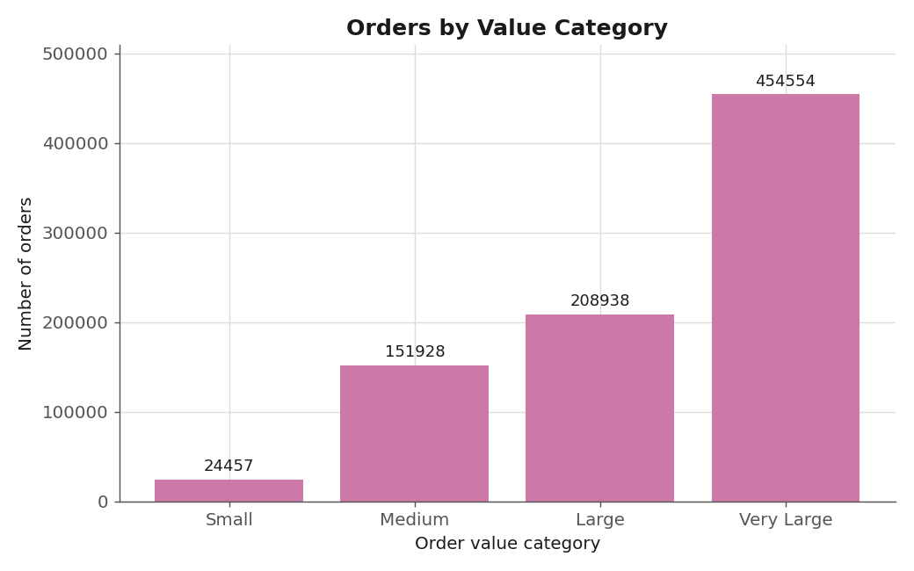

# Big Data Project - Descriptive Analysis of E-commerce Transactions

**Course:** Big Data · **Assignment:** Variant 1 - *Big Data Analysis* ·
**Analysis type chosen:** **Descriptive** (*"What happened?"*)

A Python application that generates a large synthetic dataset, processes it
with distributed / parallel frameworks, performs a **descriptive analysis**,
and produces an automatic report together with a set of visualizations.

---

## What it does

The project follows the full big-data lifecycle on ~1,000,000 e-commerce
transactions (configurable), using the four libraries required by the
assignment:

| Stage | Module | Library | Purpose |
|------:|--------|---------|---------|
| 1 | `src/generator.py` | **Faker** | Generate ~1M transactions across 10 CSV files (with NULLs and invalid rows to clean later). |
| 2 | `src/dask_processing.py` | **Dask** | Read all CSVs, clean the data, compute descriptive statistics in one optimized parallel pass, write cleaned **Parquet**. |
| 3 | `src/spark_descriptive.py` | **PySpark** | The core descriptive analysis: KPIs, distribution stats (mean/median/std/quartiles/skewness), Top-N products, revenue by category/city/month/hour. |
| 4 | `src/ray_parallel.py` | **Ray** | Parallel **map-reduce** descriptive statistics: one remote task per file, reduced on the driver; builds a global revenue histogram. |
| 5 | `src/visualize.py` | matplotlib / seaborn | 6 PNG charts (colorblind-safe palette). |
| 6 | `src/report.py` | - | Automatic report (`.txt` **and** `.html`) with conclusions, processed-record counts and per-stage execution times. |

`main.py` runs all stages end-to-end and times each one.

### Why three engines on the same data?
- **Dask** cleans the raw CSVs and writes compact Parquet (out-of-core processing).
- **Spark** runs the heavy distributed aggregations on the cleaned Parquet.
- **Ray** independently recomputes the core statistics with a hand-written
  parallel map-reduce - and the report cross-checks that all three agree, which
  validates the pipeline.

---

## Project structure

```
big-data-uni/
├── main.py                     # orchestrator (runs every stage, times them)
├── config.py                   # all settings (+ .env support)
├── logger_config.py            # console + file logging
├── requirements.txt            # dependencies
├── .env.example                # example configuration
├── src/
│   ├── generator.py            # 1) Faker data generation
│   ├── dask_processing.py      # 2) Dask cleaning + descriptive stats
│   ├── spark_descriptive.py    # 3) PySpark descriptive analysis
│   ├── ray_parallel.py         # 4) Ray parallel map-reduce stats
│   ├── visualize.py            # 5) charts
│   └── report.py               # 6) automatic .txt / .html report
├── data/                       # generated raw CSV + cleaned Parquet (git-ignored)
├── output/                     # aggregated CSV results (Spark/Dask/Ray)
└── reports/                    # DELIVERABLES: report.txt, report.html, charts/*.png
```

---

## Setup

Requires **Python 3.9+** and a **Java runtime (JDK 11/17/21)** for Spark.

```bash
python -m venv .venv
source .venv/bin/activate        # Windows: .venv\Scripts\activate
pip install -r requirements.txt
```

Optionally copy `.env.example` to `.env` and tweak the dataset size:

```bash
cp .env.example .env
```

---

## Run

```bash
# Full pipeline (generate → dask → spark → ray → visualize → report)
python main.py

# Reuse already-generated data
python main.py --skip-generate

# Run a single stage (data must already exist)
python main.py --only spark
```

Each stage can also be run on its own:

```bash
python -m src.generator
python -m src.dask_processing
python -m src.spark_descriptive
python -m src.ray_parallel
python -m src.visualize
```

### Quick test with a smaller dataset
```bash
TOTAL_RECORDS=50000 NUM_FILES=4 python main.py      # Linux/macOS
```

---

## Outputs (deliverables)

- `reports/analysis_report.txt` - plain-text automatic report.
- `reports/analysis_report.html` - richer HTML report with embedded charts.
- `reports/charts/01..06_*.png` - the six visualizations.
- `output/spark_aggregations/*.csv`, `output/dask_stats/*.csv`,
  `output/ray_stats/*.csv` - the aggregated results behind the charts.

The report contains everything the assignment's "mandatory final result"
asks for: at least 4 visualizations, an automatic report, short conclusions,
the number of processed records and the execution time of the main operations.

---

## Visualizations

Generated from a real run on 1,000,000 records (839,877 valid after cleaning).

### 1. Distribution of transaction revenue
Right-skewed distribution - most orders are small, a few are very large.



### 2. Top 10 products by revenue
`Laptop Pro 15` leads with ~$270.7M.



### 3. Revenue share by category (Pareto)
Long-tail / Pareto pattern - `Electronics` alone is 63.7% of revenue.



### 4. Monthly revenue trend
The first and last months are partial (180-day window), so they are lower.



### 5. Orders by hour of day
Order volume is roughly uniform across the 24 hours (synthetic data).



### 6. Orders by value category
Most orders fall into the "Very Large" bucket given the product price mix.


